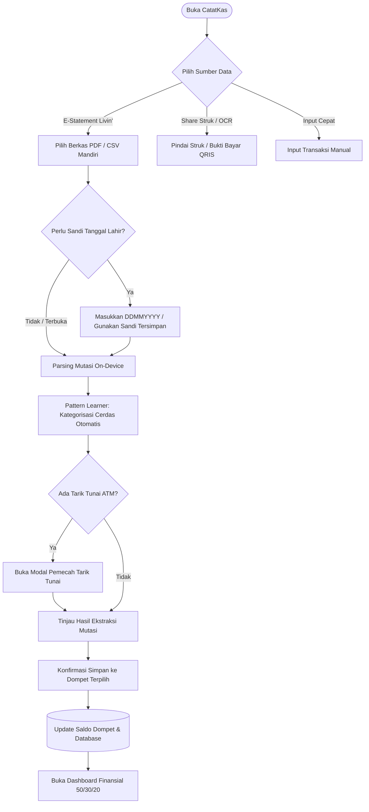
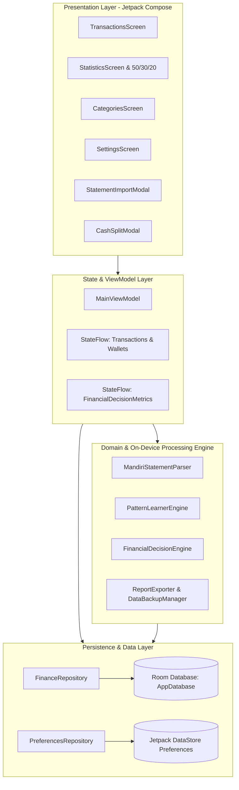
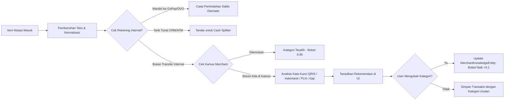
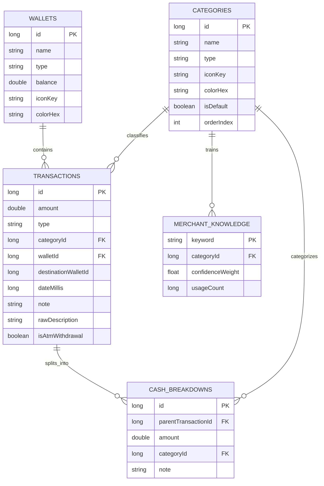
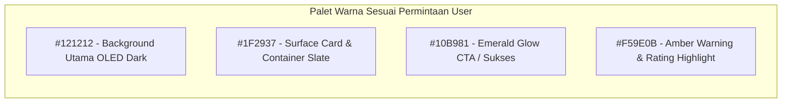

# Rencana Implementasi: Fitur Impor E-Statement Livin' Mandiri & Mesin Pembelajar Pola Finansial (Visual Identity: #121212 & #1F2937)

Dokumen ini merinci arsitektur, diagram alur Mermaid, dan strategi implementasi untuk fitur **Impor E-Statement Livin' by Mandiri**, **Mesin Pembelajar Pola Finansial (Pattern Learner)**, **Modul Pemecah Tarik Tunai (Cash Splitter)**, dan **Dashboard Keputusan Finansial (50/30/20 & Deteksi Kebocoran)** dengan menerapkan Palet Desain Khusus:
- **Background Utama**: `#121212` (OLED Deep Charcoal)
- **Kontainer & Kartu (Cards)**: `#1F2937` (Dark Slate Surface)
- **Tombol & Aksi Utama (CTA / Glowing)**: Emerald Glow `#10B981`
- **Sorotan & Warning (Accent)**: Amber `#F59E0B`

---

## 1. Diagram Alur Pengguna (User Flow)

---

## 2. Arsitektur Topologi Sistem (System Architecture)

---

## 3. Diagram Alur Mesin Pembelajar Pola (Pattern Learner Engine)

---

## 4. Diagram Entitas Basis Data (Entity Relationship)

---

## 5. Sistem Identitas Visual & Palette Warna

- **Latar Belakang (`#121212`)**: Mengurangi kelelahan mata, hemat daya layar AMOLED, dan memberikan kedalaman visual kontras tinggi.
- **Kontainer & Kartu (`#1F2937`)**: Warna Slate gelap yang lembut untuk membedakan kartu ringkasan saldo, daftar transaksi, dan modal formulir.
- **Emerald Glow (`#10B981`)**: Aksen menyala untuk tombol catat transaksi baru, konfirmasi impor mutasi, status saldo surplus, dan tab aktif.
- **Amber Accent (`#F59E0B`)**: Sorotan untuk kartu kebocoran anggaran (spending leak), status transaksi pending, serta peringatan batas 50/30/20.

---

## 6. Rencana Implementasi & Verifikasi Kode

1. **Sinkronisasi Desain Visual**: Memastikan warna `#121212`, `#1F2937`, `#10B981`, dan `#F59E0B` diterapkan secara presisi di seluruh elemen `Theme.kt`, `Color.kt`, dan kartu UI.
2. **Komponen Modal Impor E-Statement**: Menyediakan UI interaktif untuk simulasi atau pemilihan file mutasi Mandiri, dialog sandi tanggal lahir (DDMMYYYY), dan pratinjau daftar transaksi yang terdeteksi secara otomatis.
3. **Penyatuan ke Navigation & Main Screen**: Mengintegrasikan tombol aksi cepat di layar Transaksi dan Statistik untuk mengakses modul impor dan analisis 50/30/20.
4. **Verifikasi Build**: Melakukan kompilasi `compile_applet` untuk menjamin tidak ada syntax error atau ketergantungan yang rusak.
